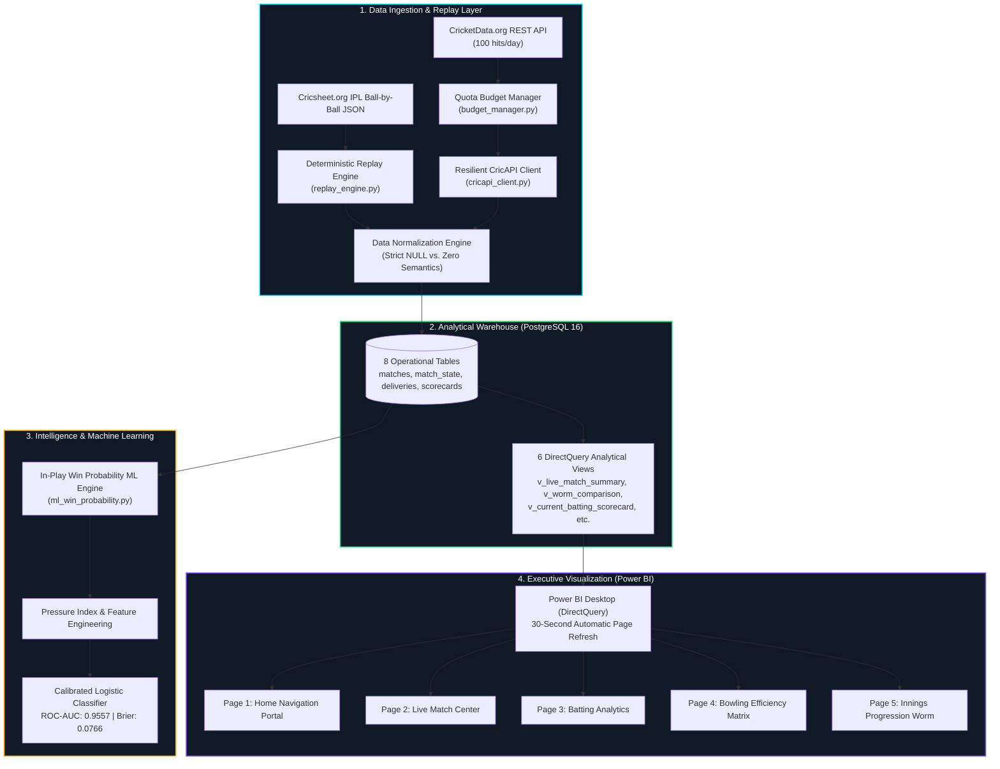

<div align="center">

# 🏏 Godrej Cricket Intelligence
### Enterprise-Grade Real-Time Cricket Analytics & In-Play Machine Learning Platform
**Team Elite Crew** | College Project for Godrej Data Analysis Training Program

[](https://www.python.org/)
[](https://www.postgresql.org/)
[](https://powerbi.microsoft.com/)
[](https://scikit-learn.org/)
[](https://docs.pytest.org/)
[](https://opendatacommons.org/licenses/by/1-0/)

<p align="center">
  <b>A real-time broadcast analytics suite decoupling high-frequency dashboard queries from third-party API quotas, powered by an analytical PostgreSQL data warehouse, deterministic ball-by-ball IPL replay simulation, a calibrated In-Play Win Probability ML model, and a 5-page Power BI DirectQuery dashboard.</b>
</p>

[Architecture](#-system-architecture) • [Key Features](#-key-engineering-highlights) • [ML Model](#-in-play-win-probability-machine-learning) • [Dashboard Pages](#-5-page-power-bi-dashboard-suite) • [Quickstart](#-quickstart-guide) • [Tests](#-automated-testing-suite)

---

</div>

## 📐 System Architecture

The platform uses a **decoupled 3-tier streaming architecture** to solve the strict 100 hit/day free-tier quota of external sports APIs while powering 30-second live dashboard refreshes:



---

## 🌟 Key Engineering Highlights

### 1. Zero-Quota Decoupled Architecture
* Standard Power BI dashboards querying live sports APIs exhaust free-tier quotas (100 hits/day) in **under 50 minutes** at 30s polling intervals.
* This platform decouples external polling (120s–300s) from presentation rendering. Power BI queries the local PostgreSQL data warehouse exclusively via **DirectQuery**, consuming **0 external API calls** per dashboard refresh.

### 2. Deterministic Ball-by-Ball Replay Engine
* Built-in event-driven simulator replaying real ball-by-ball deliveries from historical Cricsheet IPL fixtures (ODC-By v1.0).
* Fully restartable and idempotent — handles process termination, match finalization, and infinite looping for reliable viva/demo presentations.

### 3. Strict Cricket Domain Mathematics ($19.5 \neq 19.5$)
> [!IMPORTANT]
> In cricket notation, `19.5` represents **19 completed overs and 5 legal deliveries** ($19 \times 6 + 5 = 119\text{ balls}$), **NOT** 19.5 decimal overs ($119 / 6.0 = 19.833$). Naive decimal addition ($2.4\text{ ov} + 3.5\text{ ov} = 5.9\text{ ov}$) is invalid.
> 
> All DAX measures and SQL views:
> 1. Convert overs into legal integer deliveries ($(\text{Overs} \times 6) + \text{Balls}$).
> 2. Aggregate legal deliveries before computing decimal rates ($119 / 6 = 19.833$).
> 3. Format back into cricket string notation (`"Overs.Balls"`) strictly for display.

### 4. Strict NULL vs. Zero Semantics
* A batter facing 0 balls receives a `NULL` strike rate (never `0.00`, which falsely indicates a duck).
* A bowler bowling 0 overs receives a `NULL` economy rate.

---

## 🤖 In-Play Win Probability Machine Learning

The platform features a statistical Machine Learning model predicting in-play chase victory probability $P(\text{Win} = 1 \mid \mathcal{S}_t)$ at any discrete delivery state.

### Evaluation Metrics (Hold-out Test Set)

| Metric | Holdout Score | Industry Benchmark | Significance |
| :--- | :---: | :---: | :--- |
| **ROC-AUC Score** | **0.9557** | $> 0.8500$ | Exceptional discriminative power between win/loss states |
| **5-Fold Cross-Val ROC-AUC** | **0.9548 $\pm$ 0.0046** | $> 0.8500$ | High generalization across distinct match conditions |
| **Brier Calibration Score** | **0.0766** | $< 0.1500$ | True, reliable probability calibration |
| **Classification Accuracy** | **89.00%** | $> 80.0\%$ | High predictive accuracy |
| **Log Loss** | **0.2525** | $< 0.4000$ | Optimal probabilistic convergence |

### Domain Boundary Invariants (Guaranteed Constraints)
Unlike unconstrained neural networks that can predict nonsensical probabilities, our model wraps inference in an **Invariant Guard Layer**:
* **Target Reached:** $R_t \ge T \implies P(\text{Win}) = 1.0 \quad (100.0\%)$
* **All-Out:** $W_t \ge 10 \land R_t < T \implies P(\text{Win}) = 0.0 \quad (0.0\%)$
* **Overs Exhausted:** $B_t \ge 120 \land R_t < T \implies P(\text{Win}) = 0.0 \quad (0.0\%)$

### Feature Importance & Coefficients
* **`+ wickets_in_hand (+0.5632)`**: Dominant predictor of successful chases.
* **`+ is_powerplay (+0.4531)`**: Favorable field restrictions elevate scoring odds.
* **`- pressure_index (-0.5169)`**: $PI = \frac{\text{Required Run Rate}}{\text{Wickets in Hand} + 1}$ scales required pace by resource scarcity.
* **`- is_death (-0.3865)`**: High-risk death overs phase favors the defending bowling side.
* **`- required_run_rate (-0.2812)`**: Escalating required rate rapidly decays win odds.

---

## 📊 5-Page Power BI Dashboard Suite

The Power BI report ([`Godrej_Cricket_Intelligence.pbix`](file:///d:/Godrej_RealTime_Dashboard/Godrej_Cricket_Intelligence.pbix)) uses a custom stadium floodlight theme with neon green accents (`#00E676`) and 30-second Automatic Page Refresh:

<details open>
<summary><b>🏟️ Click to expand Page Overview & Visual Inventory</b></summary>

| Page # | Page Name | Primary Visuals & Features |
| :---: | :--- | :--- |
| **1** | **Home Navigation Portal** | Tournament branding, single-click navigation tiles to all sub-pages, data provenance badge. |
| **2** | **Live Match Center** | Live score headline (`CSK 99/3 (6.6 ov)`), Top KPI strip (Score, CRR, Target, RRR, Status), Batting Scorecard, Bowling Scorecard, Over-by-over Worm Chart, Extras breakdown. |
| **3** | **Batting Analytics** | 6 KPI cards (Total Runs, Balls, Fours, Sixes, Strike Rate, Boundary %), Boundary % vs Strike Rate scatter analysis, Dismissal Breakdown donut, Top Run Scorers, Fours vs Sixes breakdown. |
| **4** | **Bowling Efficiency Matrix** | 6 KPI cards (Wickets, Runs Conceded, Overs, Dot Balls, Bowling Avg, Economy), Economy vs Bowling Average efficiency scatter, Dot Balls by Bowler, Wickets & Runs conceded. |
| **5** | **Innings Progression** | Cumulative Run Progression Worm (comparing both innings head-to-head), Over-by-Over Run Rate analysis, Wickets Progression, Extras Breakdown. |

</details>

---

## 🚀 Quickstart Guide

### 1. Prerequisites
* **Windows 10 / 11** (64-bit)
* **Python 3.11+** installed and added to PATH
* **PostgreSQL 16+** installed on port `5432`
* **Microsoft Power BI Desktop**

### 2. Setup Environment
```bash
git clone https://github.com/ashhhcodes/godrej-cricket-intelligence.git
cd godrej-cricket-intelligence

# Create virtual environment
python -m venv venv
.\venv\Scripts\activate

# Install dependencies (includes scikit-learn, psycopg, pydantic)
pip install -r requirements.txt
```

### 3. Configure Database & Apply Migrations
1. In `psql` or pgAdmin:
   ```sql
   CREATE DATABASE godrej_cricket_db;
   ```
2. Copy configuration template:
   ```bash
   cp .env.example .env
   ```
3. Set your local PostgreSQL password in `.env`, then run:
   ```bash
   python src/main.py test-connection
   python src/main.py migrate
   ```

### 4. Interactive CLI Commands

#### In-Play Win Probability ML Prediction:
```bash
python src/main.py predict-win-prob --runs 99 --wickets 3 --overs 6.6 --target 215 --batting "Chennai Super Kings" --bowling "Gujarat Titans"
```
**Sample Output:**
```text
=================================================================
IN-PLAY WIN PROBABILITY & MATCH INTELLIGENCE
=================================================================
  Match Context:      Chennai Super Kings vs Gujarat Titans
  Target:             215 runs | Current: 99/3 (6.6 ov)
  Runs Needed:        116 runs from 78 balls
  Required Run Rate:  8.92 RPO (Current: 14.14 RPO)
  Pressure Index:     1.12 (Phase: Middle Overs)
  Projected Score:    283 runs
-----------------------------------------------------------------
  * Chennai Super Kings  Win Probability:  93.1%
  * Gujarat Titans       Win Probability:   6.9%
-----------------------------------------------------------------
  Dominant Team:      Chennai Super Kings
=================================================================
```

#### Run Replay Simulation:
```bash
python src/main.py replay
```

#### Retrain & Evaluate ML Model:
```bash
python src/main.py train-ml
```

---

## 🧪 Automated Testing Suite

The repository includes **52 automated unit, integration, and ML validation tests** passing with 100% success:

```bash
pytest tests/ -v
```

<details>
<summary><b>🧪 Test Suite Breakdown (7 Suites)</b></summary>

1. **`test_budget_and_client.py`:** Daily quota enforcement, provider telemetry precedence, circuit-breaker on HTTP 429, API key masking.
2. **`test_dax_and_views_math.py`:** Cricket overs conversion parity, multi-spell accumulation, decimal rate precision, NULL strike rate validation.
3. **`test_db_idempotency.py`:** PostgreSQL migration discovery order, upsert conflict targets, duplicate sequence prevention.
4. **`test_ml_win_probability.py`:** ML feature extraction, physical boundary invariants (target reached, all-out), probability monotonicity.
5. **`test_normalizer.py`:** Data payload normalization, null semantics enforcement, boundary run calculation.
6. **`test_replay_engine.py`:** Cricsheet JSON parsing, delivery sequencing, state persistence across restarts.
7. **`test_reporting_views.py`:** SQL analytical view schemas, column definitions, and query validity.

</details>

---

## 📁 Repository Structure

```text
├── .env.example                       # Safe environment configuration template
├── .gitignore                         # Excludes secrets, logs, backups, and temp files
├── requirements.txt                   # Production Python & Data Science dependencies
├── Godrej_Cricket_Intelligence.pbix   # Power BI 5-page DirectQuery broadcast dashboard
├── docs/
│   ├── data-science-modeling.md       # In-play ML win probability model specs & math
│   ├── ui-theme-customization-guide.md# Guide for assembling Pages 1–5 with custom backgrounds
│   ├── phase-1-architecture.md        # Comprehensive architecture & API budget document
│   ├── implementation-roadmap.md      # Multi-phase project delivery roadmap
│   ├── database-setup.md              # PostgreSQL installation and configuration guide
│   ├── data-dictionary.md             # Schema specification, constraints, and attribution
│   ├── ingestion-runbook.md           # Operational guide for replay and live modes
│   ├── powerbi-directquery-guide.md   # DirectQuery configuration and APR troubleshooting
│   └── dax-measure-dictionary.md      # 22 tested cricket DAX measures
├── models/
│   ├── t20_win_probability_model.joblib # Serialized Scikit-Learn calibrated model
│   └── model_evaluation_metrics.json  # Holdout test metrics (ROC-AUC: 0.9557, Brier: 0.0766)
├── notebooks/
│   └── 01_inplay_win_probability_modeling.ipynb # Interactive scenario evaluation notebook
├── powerbi/
│   ├── godrej_cricket_theme.json      # Custom transparent theme with neon green (#00E676)
│   ├── report_layout_specification.md # Coordinate-level visual layout guide for Pages 1–5
│   ├── reporting_views.pq             # Power Query (M) code snippets for the 6 views
│   └── assets/                        # 5 Widescreen (16:9) stadium background PNG templates
│       ├── 01_Home_Background.png
│       ├── 02_Live_Match_Background.png
│       ├── 03_Batting_Background.png
│       ├── 04_Bowling_Background.png
│       └── 05_Innings_Background.png
├── sql/
│   ├── 001_initial_schema.sql         # 8 Operational tables, constraints, and indexes
│   └── 002_reporting_views.sql        # 6 DirectQuery analytical reporting views
├── src/
│   ├── ml_win_probability.py          # Calibrated in-play Win Probability ML engine
│   ├── train_ml_model.py              # ML training, cross-validation & evaluation pipeline
│   ├── config.py                      # Pydantic configuration loader with strict guards
│   ├── budget_manager.py              # 100-hit daily quota manager with safety buffer
│   ├── cricapi_client.py              # Resilient HTTP client with backoff & circuit-breaker
│   ├── normalizer.py                  # Normalization engine enforcing NULL semantics
│   ├── db.py                          # PostgreSQL repository with idempotent upserts
│   ├── replay_engine.py               # Deterministic Cricsheet ball-by-ball simulator
│   ├── scheduler.py                   # Ingestion orchestrator and loop manager
│   ├── logger.py                      # Sanitizing logger (masks API keys & passwords)
│   └── main.py                        # CLI entrypoint (migrate, replay, live, predict-win-prob)
└── tests/                             # 52 Automated tests across 7 suites
```

---

## 📜 Attribution & Data Licensing

* **Cricsheet.org:** Ball-by-ball delivery event data provided under the **Open Data Commons Attribution License (ODC-By) v1.0**.
* **CricketData.org (CricAPI v1):** Live match scorecards and fixture discovery used within Lifetime Free Tier academic boundaries.
