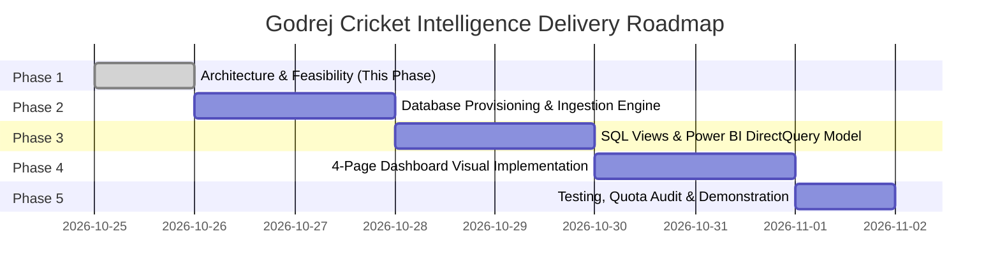

# Implementation Roadmap: Godrej Cricket Intelligence
## Multi-Phase Technical Delivery Plan

**Project:** Godrej Data Analysis Training Program — Real-Time Cricket Analytics Dashboard  
**Author:** Senior Data Engineer, Power BI Architect & Software Testing Engineer  
**Status:** Approved for Review (Phase 1 Baseline)

---

## 1. Roadmap Overview & Timeline

The implementation of the **Godrej Cricket Intelligence** project is organized into five sequential, test-driven phases. Each phase has concrete dependencies, output artifacts, and strict verification gates.

---

## 2. Phase-by-Phase Technical Specifications

### Phase 1: Architecture & API Feasibility (Current Baseline)
* **Status:** Complete & Submitted for Review.
* **Objective:** Verify external API constraints, design PostgreSQL relational schema, formulate quota-aware polling strategy, establish Power BI DirectQuery feasibility, and lock visual direction.
* **Key Deliverables:**
  * `docs/phase-1-architecture.md`: Comprehensive technical architecture and feasibility study.
  * `docs/implementation-roadmap.md`: Multi-phase execution schedule and verification gates.
  * `.gitignore`: Security exclusions for credentials, environments, and caches.
  * `.env.example`: Secure environment configuration template with placeholders.
* **Verification Gate:** Explicit user review and sign-off before any code implementation.

---

### Phase 2: PostgreSQL Schema Setup, Offline Fixtures & Ingestion Engine
* **Estimated Duration:** 2 Days
* **Prerequisites:** User approval of Phase 1 architecture and database schema.
* **Detailed Work Breakdown:**
  1. **Database Schema Deployment:**
     * Create PostgreSQL database `godrej_cricket_db`.
     * Execute DDL migration scripts for tables: `matches`, `match_state`, `innings`, `batting_scorecard`, `bowling_scorecard`, `score_snapshots`, `ball_events`, and `api_usage`.
     * Establish indexes for foreign keys, timestamps, and status fields.
  2. **Offline Fixtures Repository:**
     * Save representative offline JSON fixtures in `tests/fixtures/`:
       * `current_matches_live.json`: Live fixture state.
       * `match_info_ipl.json`: Metadata for an IPL encounter.
       * `match_scorecard_t20.json`: Detailed batting/bowling scorecard.
       * `cricsheet_replay_balls.json`: Granular ball-by-ball sample.
  3. **Python Ingestion Service Development:**
     * `src/config.py`: Pydantic settings loading from `.env` with validation.
     * `src/api_client.py`: Resilient HTTP client for CricketData.org with exponential backoff, rate limit header tracking, and circuit breaker.
     * `src/quota_tracker.py`: Thread-safe Token Bucket maintaining local daily hit counts against the 100-hit limit.
     * `src/normalizer.py`: Parsing and validation logic enforcing explicit `NULL` vs. `0` semantics.
     * `src/db_loader.py`: SQLAlchemy / psycopg3 idempotent upsert engine (`ON CONFLICT DO UPDATE`).
     * `src/simulator.py`: Chronological replay engine for offline demonstration mode (`INGESTION_MODE=fixture_replay`).
     * `src/main.py`: CLI entrypoint with modes: `--live`, `--simulate`, and `--audit`.
  4. **Deterministic Unit & Integration Testing:**
     * Pytest test suite validating idempotent upserts, quota lockout, and normalizer logic without burning external API credits.
* **Phase 2 Outputs:**
  * Runnable Python package in `src/`.
  * Verified PostgreSQL database with tables and sample records.
  * Passing test suite (`pytest tests/`).

---

### Phase 3: Analytical SQL Views & Power BI DirectQuery Data Model
* **Estimated Duration:** 2 Days
* **Prerequisites:** Populated PostgreSQL database from Phase 2.
* **Detailed Work Breakdown:**
  1. **Analytical SQL Views (DirectQuery Query Acceleration):**
     * Build indexed reporting views to minimize DAX complexity:
       * `v_live_match_summary`: Aggregates active innings, CRR, RRR, target, wickets, and overs.
       * `v_batting_leaderboard`: Aggregates runs, balls, strike rates, 4s, 6s, and boundary percentages.
       * `v_bowling_figures`: Aggregates overs, maidens, wickets, runs conceded, and economy rates.
       * `v_worm_comparison`: Pivots cumulative runs by over for both teams.
       * `v_partnership_current`: Derives active partnership runs and balls faced.
       * `v_api_telemetry`: Summarizes daily quota usage, hit history, and remaining credits.
  2. **Power BI DirectQuery Model Configuration:**
     * Connect Power BI Desktop to local PostgreSQL via the native connector.
     * Establish star-adjacent relationship model with 1-to-many single direction filters.
     * Enable referential integrity on foreign key relationships.
  3. **DAX Measures Formulation:**
     * Implement concise, DirectQuery-compliant measures:
       * `[Total Runs] = SUM(innings[total_runs])`
       * `[Current Run Rate] = MAX(match_state[current_run_rate])`
       * `[Required Run Rate] = MAX(match_state[required_run_rate])`
       * `[Boundary %] = DIVIDE(SUM(batting_scorecard[fours])*4 + SUM(batting_scorecard[sixes])*6, SUM(batting_scorecard[runs]), 0)`
       * `[Change Detection Timestamp] = MAX(match_state[updated_at_utc])`
  4. **Automatic Page Refresh (APR) Configuration:**
     * Configure Change Detection on the active report canvas linked to `[Change Detection Timestamp]`.
     * Set fallback fixed refresh interval to 30 seconds.
* **Phase 3 Outputs:**
  * SQL migration script `sql/02_reporting_views.sql`.
  * Power BI Template / Model file (`godrej_cricket_model.pbit`).
  * DirectQuery query performance benchmark report.

---

### Phase 4: Power BI Report Design & Visual System Implementation
* **Estimated Duration:** 2 Days
* **Prerequisites:** Validated DirectQuery semantic model and analytical views from Phase 3.
* **Detailed Work Breakdown:**
  1. **Visual Theme & Style Guide Application:**
     * Create custom Power BI JSON theme file (`themes/godrej_cricket_theme.json`) embedding:
       * Deep Field Green (`#1E5631`) primary accent.
       * Warm White (`#F8F9FA`) background for analytical pages.
       * Dark Pitch (`#11161B`) background for the Live Scoreboard.
       * Consistent Segoe UI / DIN typography and card surface tokens.
  2. **Page 1: Live Match Center (Dark Theme):**
     * High-contrast live score KPI strip (Target, Score, Overs, CRR, RRR).
     * Active partnership card (Runs, Balls, Current Batters).
     * Compact Batting & Bowling tables with right-aligned numeric data.
     * Worm chart (Dual-line cumulative run comparison).
     * Live Status Badge (`LIVE SOURCE` vs. `SIMULATED REPLAY`).
  3. **Page 2: Batting Analytics (Light Theme):**
     * Complete tournament batter leaderboard with boundary run percentages.
     * Scatter chart: Strike Rate vs. Balls Faced (Power hitters vs. Anchors).
     * Dismissal breakdown visual.
     * Phase-by-phase scoring analysis (Powerplay, Middle, Death overs).
  4. **Page 3: Bowling Analytics (Light Theme):**
     * Bowler discipline table (Overs, Maidens, Economy, Average, Strike Rate).
     * Economy vs. Wickets matrix visual.
     * Bowling extras breakdown (Wides, No-Balls, Byes).
     * Bowling phase containment metrics.
  5. **Page 4: Match Insights & System Telemetry (Light Theme):**
     * Venue toss advantage & match outcome correlations.
     * Head-to-head match history matrix.
     * Live system telemetry card: Daily API credits consumed, remaining hits, and query latency.
* **Phase 4 Outputs:**
  * Completed Power BI Report (`Godrej_Cricket_Intelligence.pbix`).
  * Exported theme file (`themes/godrej_cricket_theme.json`).
  * UI Walkthrough documentation with visual screenshots.

---

### Phase 5: End-to-End Testing, Quota Audit & Demonstration Runbook
* **Estimated Duration:** 1 Day
* **Prerequisites:** Fully integrated ingestion service, database, and Power BI report.
* **Detailed Work Breakdown:**
  1. **Quota-Limit Soak Test:**
     * Run the ingestion service in Live Mode for 1 hour; verify that total API hits never exceed the budgeted 24-hit allocation.
     * Simulate a 429 Rate Limit response; verify exponential backoff and circuit breaker behavior.
  2. **Automatic Page Refresh (APR) Stress Test:**
     * Validate that Power BI Desktop refreshes visuals within 2 seconds of database upserts.
     * Measure PostgreSQL connection count and memory footprint under continuous DirectQuery polling.
  3. **College Demonstration Rehearsal:**
     * Execute full 30-minute demonstration rehearsal using `fixture_replay` mode.
     * Verify that simulated overs advance smoothly every 30 seconds and update all 4 Power BI pages in real time.
     * Verify that the `SIMULATED REPLAY` badge is prominently displayed.
  4. **Final Packaging & Documentation:**
     * Prepare `README.md` with step-by-step local setup instructions (Python virtualenv, PostgreSQL database creation, Power BI opening steps).
     * Prepare student presenter speaking points and slide-ready architectural diagrams.
* **Phase 5 Outputs:**
  * Finalized GitHub repository.
  * Complete project documentation and demonstration runbook (`docs/demo-runbook.md`).

---

## 3. Verification Gates & Progression Checklist

| Gate | Checkpoint | Prerequisite for Advancement | Verification Method |
| :---: | :--- | :--- | :--- |
| **Gate 1** | **Phase 1 Sign-Off** | Architecture & Feasibility approved by user. | User explicit approval prompt. |
| **Gate 2** | **Ingestion & DB Health** | All unit tests pass; PostgreSQL upsert runs without duplicating rows. | Automated `pytest` execution & SQL count query. |
| **Gate 3** | **DirectQuery Performance** | Power BI DirectQuery visual execution time < 500ms on local PostgreSQL. | Power BI Performance Analyzer trace log. |
| **Gate 4** | **Quota Compliance** | Zero risk of exceeding 100 hits/day during live demonstrations. | Inspection of `api_usage` audit log table. |
| **Gate 5** | **Demonstration Readiness** | Replay simulation advances live score visuals every 30 seconds smoothly. | Live end-to-end rehearsal in Power BI Desktop. |
