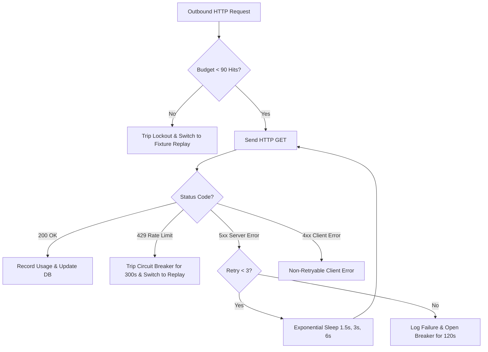

# Ingestion Engine Operations Runbook
## Godrej Cricket Intelligence

This runbook covers operational execution, dual-mode configuration, quota budget management, failure recovery, and diagnostic procedures for the Python data pipeline.

---

## 1. Engine Modes & Operational Philosophy

The ingestion engine operates in two distinct modes configured via `.env` or CLI flags:

```
[Mode 1: Fixture Replay (Default)] ──> Offline Cricsheet T20 Fixture ──> Sequential Tick (30s) ──> PostgreSQL
[Mode 2: Live Ingestion (Opt-In)]  ──> CricketData.org (CricAPI v1) ──> Token Bucket (100 Hits) ──> PostgreSQL
```

### Mode Comparison Matrix

| Property | `fixture_replay` (Default) | `live` (Explicit Opt-In) |
| :--- | :--- | :--- |
| **Data Source** | Offline Cricsheet historical T20 dataset (`tests/fixtures/cricsheet_t20_match.json`) | CricketData.org / CricAPI v1 REST endpoints |
| **API Quota Cost** | **0 hits** (Completely offline) | **1 hit per request** (Capped at 100 hits/day) |
| **Provenience Flag**| `is_simulated = TRUE` | `is_simulated = FALSE` |
| **Dashboard Indicator**| `DEMO / SIMULATED DATA` | `OFFICIAL LIVE SOURCE` |
| **Update Interval** | Configurable (default `30` seconds) | Polling budget (default `120–150` seconds) |
| **Best Used For** | Development, testing, presentations, grading, evaluation | Actual live match days during active game hours |

---

## 2. Command-Line Reference

The pipeline is managed via the unified CLI entrypoint [`src/main.py`](file:///d:/Godrej_RealTime_Dashboard/src/main.py):

### 1. Database Connection Diagnostics
Verifies that PostgreSQL is reachable before launching ingestion:
```powershell
python src/main.py test-connection
```

### 2. Apply Schema Migrations
Applies tables and reporting views:
```powershell
python src/main.py migrate
```

### 3. Run Replay Simulator (Default Demonstration Mode)
Launches the deterministic replay engine advancing one delivery every 30 seconds:
```powershell
python src/main.py replay
```

To run for a specific number of delivery ticks (e.g., 20 balls for testing):
```powershell
python src/main.py replay --cycles 20
```

### 4. Run Live API Ingestion
Requires explicit opt-in in `.env` (`ALLOW_LIVE_API=true` and a valid `CRICAPI_KEY`):
```powershell
python src/main.py live
```

### 5. Inspect Quota & System Telemetry
Displays real-time credit consumption and pipeline health status:
```powershell
python src/main.py status
```

---

## 3. Quota-Budget Management & Polling Policy

### Daily Quota Limits
* **Lifetime Free Ceiling:** Exactly **100 hits per 24-hour UTC day**.
* **Safety Margin Buffer:** Default **10 hits** reserved.
* **Effective Request Ceiling:** $$100 - 10 = 90\text{ hits / day}$$

### Adaptive Pacing Policy
To stay well within budget during an evaluation session:
1. **Match Discovery (`/currentMatches`):** Polled only once at startup or when transitioning between matches (1 hit).
2. **Match Scorecard (`/match_scorecard`):** Polled every 120–150 seconds for the active match.
   * A 30-minute demonstration consumes:
     $$\frac{30\text{ minutes}}{2.5\text{ minutes/request}} = 12\text{ hits}$$
   * Leaves 78 permitted hits for subsequent testing.

### Quota Lockout & Automatic Failover
If `hitsToday >= daily_limit - safety_margin` (90 hits):
1. Outbound requests to CricAPI are immediately blocked.
2. A critical alert is logged: `Quota ceiling reached. Request aborted to protect budget.`
3. The scheduler triggers **automatic failover** to `fixture_replay` mode, preventing pipeline crashes and ensuring the Power BI dashboard continues refreshing uninterrupted.

---

## 4. Error Handling & Circuit Breaker Logic

The CricAPI client implements automated failure recovery:



* **HTTP 429 (Too Many Requests):** Trips the circuit breaker for 300 seconds. No further API calls are attempted.
* **HTTP 5xx (Server Errors):** Retries up to 3 times using exponential backoff ($1.5\text{s} \to 3.0\text{s} \to 6.0\text{s}$).
* **Connection Timeouts:** Default socket timeout is 10.0 seconds.

---

## 5. Graceful Startup & Shutdown Procedures

### Starting the Ingestion Daemon
```powershell
# In PowerShell:
python src/main.py replay
```

### Graceful Termination
Press `Ctrl+C` in the terminal or issue a `SIGINT` / `SIGTERM` signal:
* The scheduler intercepts the signal via registered signal handlers.
* It finishes committing any active database transaction.
* Closes the PostgreSQL connection cleanly.
* Emits a shutdown confirmation log and exits with code 0.

---

## 6. Telemetry & Log Monitoring

Logs are streamed to `stdout` and persisted to `logs/ingestion.log`. All API keys and database credentials are automatically masked via `SensitiveDataFilter`.

### Sample Healthy Log Stream
```text
[2026-10-25 15:30:00] [INFO] [main] Launching Ingestion Service in 'fixture_replay' mode...
[2026-10-25 15:30:00] [INFO] [db_repository] Establishing PostgreSQL connection to localhost:5432/godrej_cricket_db
[2026-10-25 15:30:00] [INFO] [replay_engine] Loaded fixture: Indian Premier League (2 innings available)
[2026-10-25 15:30:00] [INFO] [replay_engine] Initialized fixture replay for match_id=1 ('Gujarat Titans vs Chennai Super Kings, IPL Match 74')
[2026-10-25 15:30:30] [INFO] [scheduler] Replay Step: Inning 1 | Over 0.1 | Gujarat Titans 0/0 | WP Saha (0) vs DL Chahar
[2026-10-25 15:31:00] [INFO] [scheduler] Replay Step: Inning 1 | Over 0.2 | Gujarat Titans 4/0 | WP Saha (4) vs DL Chahar
```
