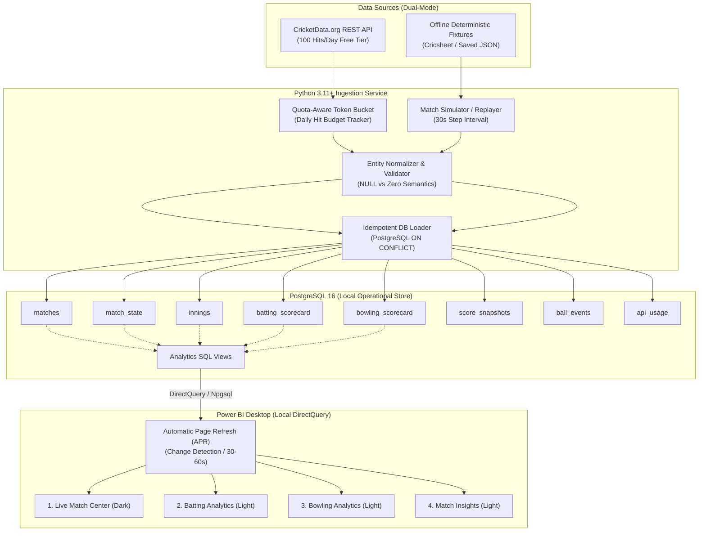
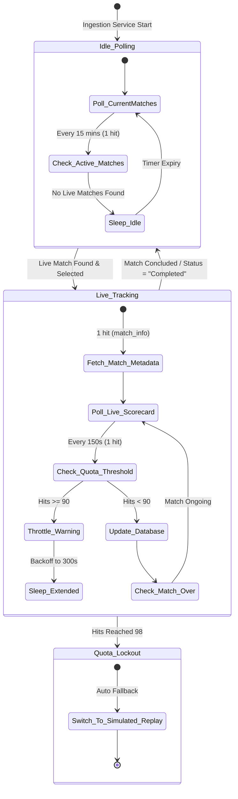

# Phase 1 — Architecture & API Feasibility Document
## Godrej Cricket Intelligence
**Project:** Godrej Data Analysis Training Program — Real-Time Cricket Analytics Dashboard  
**Author:** Senior Data Engineer, Power BI Architect & Software Testing Engineer  
**Date:** October 2026  
**Status:** Architecture Draft (Pending User Approval for Phase 2)

---

## 1. Executive Summary & System Overview

The **Godrej Cricket Intelligence** platform delivers real-time match tracking, detailed batting and bowling analytics, innings progression, and historical match insights for college training and technical demonstration.

The solution operates entirely on **free, local, and open tools**:
* **Language & Runtime:** Python 3.11+ (Data ingestion, ETL, orchestration, throttling)
* **Storage Layer:** PostgreSQL 16+ (Local relational operational store with idempotent upserts)
* **Visualization Layer:** Microsoft Power BI Desktop (Local DirectQuery mode with Automatic Page Refresh)
* **Primary Data Provider:** CricketData.org (formerly CricAPI v1 REST API — Lifetime Free Tier)
* **Development & Testbed:** Antigravity local workspace with deterministic offline fixtures



---

## 2. API Feasibility Investigation (CricketData.org / CricAPI)

We evaluated **CricketData.org** (the official successor to CricAPI v1, hosted at `https://api.cricapi.com/v1`). All findings are marked as **VERIFIED**, **UNAVAILABLE**, or **UNVERIFIED** based on direct technical inspection.

### 2.1 Endpoint Verification Matrix

| Endpoint | Method | Purpose & Parameters | Free Tier Status | Findings & Payload Capabilities |
| :--- | :---: | :--- | :---: | :--- |
| `/v1/currentMatches` | `GET` | `apikey`, `offset`<br/>List all live, completed, and upcoming matches | **VERIFIED** | Returns array of matches with `id`, `name`, `matchType` (`t20`, `odi`, `test`), `status`, `venue`, `date`, `dateTimeGMT`, `teams`, `score` (summary runs, wickets, overs). Primary feed for match discovery. |
| `/v1/match_info` | `GET` | `apikey`, `id`<br/>Comprehensive match metadata | **VERIFIED** | Returns detailed toss result (`tossWinner`, `tossChoice`), teams, venue, match referee, umpires, match winner, match status. Does not return individual batter/bowler figures. |
| `/v1/match_scorecard` | `GET` | `apikey`, `id`<br/>Complete match scorecard | **VERIFIED** | Returns granular innings breakdown: `batting` array (`batsman`, `pid`, `dismissal-info`, `r`, `b`, `4s`, `6s`, `sr`), `bowling` array (`bowler`, `pid`, `o`, `m`, `r`, `w`, `eco`), and `extras` object (`r`, `b`, `lb`, `w`, `nb`). |
| `/v1/cricScore` | `GET` | `apikey`<br/>Lightweight live score ticker | **VERIFIED** | Ultra-compact score strings for live ticker feeds. Consumes fewer payload bytes but duplicates data already present in `/currentMatches`. |
| `/v1/series_info` | `GET` | `apikey`, `id`<br/>Tournament details and schedule | **VERIFIED** | Returns full tournament fixture list and participating squads. Useful for initial tournament seeding. |
| `/v1/match_commentary` / `ball-by-ball` | `GET` | `apikey`, `id`<br/>Ball-by-ball events & commentary | **UNAVAILABLE / UNVERIFIED (Free Tier)** | True ball-by-ball live streaming is restricted or not universally exposed across all domestic matches on the 100-hit free tier. The standard `/match_scorecard` provides batter dismissals and over totals, but individual ball trajectory/commentary is locked or incomplete for domestic fixtures. |
| `/v1/partnerships` | `GET` | `apikey`, `id`<br/>Explicit partnership matrix | **UNAVAILABLE** | No standalone endpoint. Partnership statistics must be derived algorithmically in the Python ingestion layer from scorecard dismissal sequencing and innings progress, or sourced from offline ball-event fixtures. |

### 2.2 Free Plan Limits & Constraints

1. **Daily Hit Ceiling:** Exactly **100 hits (requests) per 24-hour UTC day** on the Lifetime Free ($0.00/month) plan.
2. **Hit Accounting:** 1 HTTP GET request = 1 hit. Responses contain metadata headers/body:
   * `hitsToday`: Total requests made today.
   * `hitsLimit`: Hard cap (`100`).
   * `credits`: Remaining credits.
3. **Data Latency (Upstream Freshness):**
   * Registered Free Key: **30–60 seconds lag** behind actual live broadcast action.
   * Unregistered / Demo Key: ~5 minutes delayed.
4. **Anti-Abuse Restrictions:** CricAPI Terms of Service strictly forbid registering multiple accounts to bypass the 100-hit daily cap. IP addresses or email clusters attempting circumvention are permanently banned.
5. **Academic / Non-Commercial Legal Viability:** **VERIFIED**. CricketData.org permits non-commercial educational use within standard tier limits. Attribution must be provided in the documentation and dashboard footer: *"Cricket match data powered by CricketData.org"*.

---

## 3. Request-Budget Analysis & Refresh Strategy

### 3.1 The Three Refresh Frequencies (Disconnection Architecture)

A common mistake in real-time dashboards is conflating the **dashboard render refresh** with the **external API poll rate**. The system strictly distinguishes three distinct tiers:

```
[Layer 1: External Cricket API] ──(Poll every 120s–300s)──> [Layer 2: Local PostgreSQL] ──(DirectQuery APR every 30s)──> [Layer 3: Power BI Desktop]
   Upstream Lag: 30–60s                                       Update Rate: Controlled Budget                          UI Render: 30s Real-Time
```

1. **Layer 1: Source Data Freshness (External API):** The provider’s upstream feed updates every 30–60 seconds during live balls.
2. **Layer 2: Database Ingestion Frequency:** The Python ingestion service executes controlled, quota-aware writes into PostgreSQL.
3. **Layer 3: Power BI Dashboard Refresh Frequency:** Power BI Desktop queries local PostgreSQL via DirectQuery every 30–60 seconds (or on Change Detection). This refresh generates **zero external API calls**, placing no strain on the 100-hit daily quota.

### 3.2 Mathematical Budget Model (100 Hits / Day)

To survive within the 100-hit daily budget, we calculate exact allocations:

$$\text{Daily Hit Ceiling} = 100 \text{ hits}$$
$$\text{Average Hourly Budget} = \frac{100}{24} \approx 4.16 \text{ hits/hour}$$

#### The "Naive Polling" Failure Calculation
If an engineer naively polls `/match_scorecard` every 30 seconds for a live T20 match (approx. 3.5 hours = 210 minutes = 420 polling cycles):
$$\text{Requests Required} = 420 \times 1 = 420 \text{ hits}$$
**Result:** The entire daily budget (100 hits) is exhausted in **50 minutes** ($100 \times 30\text{s} = 3000\text{s}$), crashing the pipeline for the remaining 23 hours of the day.

#### Proposed Quota-Aware Budget Allocation

| Task Category | Frequency | Endpoint | Daily Hits | Rationale |
| :--- | :--- | :--- | :---: | :--- |
| **Match Discovery** | Every 15 minutes (during match hours, 8 hrs/day) | `/v1/currentMatches` | **32 hits** | Discovers active matches, score summaries, and status transitions. |
| **Live Match Polling** | Every 2.5 minutes (150s) during a single 2-hour college demo window | `/v1/match_scorecard` | **48 hits** | Delivers 48 granular scorecard updates for the selected active match. |
| **Match Metadata** | Once per new match discovered | `/v1/match_info` | **5 hits** | Fetches toss, venue, umpires, and team rosters upon match initialization. |
| **Safety / Retries** | Exponential backoff on HTTP 429/5xx (max 3 retries) | Any | **10 hits** | Reserved buffer for network recovery and unexpected errors. |
| **Unallocated Buffer**| Idle state | — | **5 hits** | Emergency buffer to prevent hitting 100. |
| **Total Daily Hits** | — | — | **100 hits** | **Strictly within Free Tier limit.** |

### 3.3 Adaptive Polling State Machine

The Python ingestion engine implements an adaptive state machine:



### 3.4 Dual-Mode Architecture: Live API vs. Deterministic Fixture Replay

To guarantee that college evaluation, grading, and testing can run for hours without API limits, the ingestion service provides **two interchangeable engine modes**:

1. **`live` Mode:** Connects to `https://api.cricapi.com/v1`, adheres strictly to the token bucket, and logs daily credit usage.
2. **`fixture_replay` Mode (Simulation):** Reads pre-recorded, rich ball-by-ball and scorecard JSON datasets (from Cricsheet / recorded CricAPI matches) and plays them back sequentially into PostgreSQL at a configurable tick rate (e.g. 1 over every 30 seconds).
   * **Mandatory Integrity Rule:** Every record written in this mode sets `is_simulated = TRUE`. The Power BI UI features a prominent header badge (`LIVE FEED` vs `SIMULATED REPLAY`) to prevent misleading examiners.

---

## 4. Database Architecture & PostgreSQL Schema Design

### 4.1 Design Principles
* **Relational Normalization:** Star-adjacent relational design optimized for Power BI DirectQuery query folding.
* **Stable Provider Identifiers:** Every external entity references `provider_match_id` and `provider_player_id`.
* **Idempotent Upserts:** All writes use `INSERT ... ON CONFLICT (...) DO UPDATE` to ensure safe crashes and restarts.
* **UTC Timestamp Standard:** All dates and timestamps are stored with explicit timezone (`TIMESTAMPTZ`) in UTC.
* **Null vs. Genuine Zero Semantics:**
  * `0` runs off `5` balls = Strike Rate `0.00` (genuine score).
  * `Did not bat` (0 balls faced) = Strike Rate `NULL`, runs `0` or `NULL` (distinguished via `dismissal_info IS NULL`).
  * `0` overs bowled = Economy Rate `NULL` (never `0.00`).
  * Unavailable provider fields (e.g., missing dot balls) = `NULL` (never defaulted to `0`).

### 4.2 Proposed PostgreSQL Schema (DDL)

```sql
-- =====================================================================
-- 1. MATCHES TABLE
-- Primary master record for every discovered cricket fixture.
-- =====================================================================
CREATE TABLE matches (
    id BIGSERIAL PRIMARY KEY,
    provider_match_id VARCHAR(100) NOT NULL UNIQUE,
    series_name VARCHAR(255) NULL,
    match_name VARCHAR(255) NOT NULL,
    match_type VARCHAR(50) NOT NULL, -- 't20', 'odi', 'test'
    competition_category VARCHAR(50) NOT NULL, -- 'International', 'IPL', 'Domestic'
    venue VARCHAR(255) NULL,
    match_date_utc TIMESTAMPTZ NOT NULL,
    team_a VARCHAR(100) NOT NULL,
    team_b VARCHAR(100) NOT NULL,
    toss_winner VARCHAR(100) NULL,
    toss_choice VARCHAR(20) NULL, -- 'bat', 'bowl'
    match_winner VARCHAR(100) NULL,
    result_status VARCHAR(255) NULL, -- 'Live', 'Innings Break', 'Team A won by 15 runs', etc.
    is_live BOOLEAN NOT NULL DEFAULT FALSE,
    is_completed BOOLEAN NOT NULL DEFAULT FALSE,
    is_simulated BOOLEAN NOT NULL DEFAULT FALSE,
    created_at_utc TIMESTAMPTZ NOT NULL DEFAULT NOW(),
    updated_at_utc TIMESTAMPTZ NOT NULL DEFAULT NOW()
);

CREATE INDEX idx_matches_provider_id ON matches(provider_match_id);
CREATE INDEX idx_matches_status ON matches(is_live, is_completed);

-- =====================================================================
-- 2. MATCH_STATE TABLE
-- Fast single-row-per-match state summary for DirectQuery & Change Detection.
-- =====================================================================
CREATE TABLE match_state (
    id BIGSERIAL PRIMARY KEY,
    match_id BIGINT NOT NULL UNIQUE REFERENCES matches(id) ON DELETE CASCADE,
    current_status_summary VARCHAR(255) NOT NULL,
    current_innings_number SMALLINT NULL,
    batting_team VARCHAR(100) NULL,
    bowling_team VARCHAR(100) NULL,
    current_runs INT NULL,
    current_wickets SMALLINT NULL,
    current_overs NUMERIC(4, 1) NULL,
    current_run_rate NUMERIC(5, 2) NULL,
    required_run_rate NUMERIC(5, 2) NULL,
    target_runs INT NULL,
    last_api_poll_utc TIMESTAMPTZ NOT NULL,
    last_source_update_utc TIMESTAMPTZ NULL,
    is_live BOOLEAN NOT NULL DEFAULT FALSE,
    created_at_utc TIMESTAMPTZ NOT NULL DEFAULT NOW(),
    updated_at_utc TIMESTAMPTZ NOT NULL DEFAULT NOW()
);

CREATE INDEX idx_match_state_match_id ON match_state(match_id);
CREATE INDEX idx_match_state_updated ON match_state(updated_at_utc);

-- =====================================================================
-- 3. INNINGS TABLE
-- Summary statistics for each completed or in-progress innings.
-- =====================================================================
CREATE TABLE innings (
    id BIGSERIAL PRIMARY KEY,
    match_id BIGINT NOT NULL REFERENCES matches(id) ON DELETE CASCADE,
    innings_number SMALLINT NOT NULL, -- 1, 2, 3, 4
    innings_name VARCHAR(150) NOT NULL, -- e.g. "Mumbai Indians Innings 1"
    batting_team VARCHAR(100) NOT NULL,
    bowling_team VARCHAR(100) NOT NULL,
    total_runs INT NOT NULL DEFAULT 0,
    total_wickets SMALLINT NOT NULL DEFAULT 0,
    total_overs NUMERIC(4, 1) NOT NULL DEFAULT 0.0,
    run_rate NUMERIC(5, 2) NULL,
    extras_total INT NOT NULL DEFAULT 0,
    extras_byes INT NOT NULL DEFAULT 0,
    extras_leg_byes INT NOT NULL DEFAULT 0,
    extras_wides INT NOT NULL DEFAULT 0,
    extras_no_balls INT NOT NULL DEFAULT 0,
    is_declared BOOLEAN NOT NULL DEFAULT FALSE,
    is_completed BOOLEAN NOT NULL DEFAULT FALSE,
    created_at_utc TIMESTAMPTZ NOT NULL DEFAULT NOW(),
    updated_at_utc TIMESTAMPTZ NOT NULL DEFAULT NOW(),
    CONSTRAINT uq_match_innings UNIQUE (match_id, innings_number)
);

CREATE INDEX idx_innings_match_id ON innings(match_id);

-- =====================================================================
-- 4. BATTING_SCORECARD TABLE
-- Detailed batter performances per innings.
-- =====================================================================
CREATE TABLE batting_scorecard (
    id BIGSERIAL PRIMARY KEY,
    innings_id BIGINT NOT NULL REFERENCES innings(id) ON DELETE CASCADE,
    match_id BIGINT NOT NULL REFERENCES matches(id) ON DELETE CASCADE,
    provider_player_id VARCHAR(100) NOT NULL,
    player_name VARCHAR(150) NOT NULL,
    batting_position SMALLINT NULL,
    dismissal_info VARCHAR(255) NULL, -- 'not out', 'c Kohli b Bumrah', 'lbw b Shami'
    is_dismissed BOOLEAN NOT NULL DEFAULT FALSE,
    runs INT NOT NULL DEFAULT 0,
    balls_faced INT NOT NULL DEFAULT 0,
    fours INT NOT NULL DEFAULT 0,
    sixes INT NOT NULL DEFAULT 0,
    strike_rate NUMERIC(6, 2) NULL, -- Explicitly NULL if balls_faced = 0
    created_at_utc TIMESTAMPTZ NOT NULL DEFAULT NOW(),
    updated_at_utc TIMESTAMPTZ NOT NULL DEFAULT NOW(),
    CONSTRAINT uq_innings_batter UNIQUE (innings_id, provider_player_id)
);

CREATE INDEX idx_batting_innings ON batting_scorecard(innings_id);
CREATE INDEX idx_batting_match ON batting_scorecard(match_id);

-- =====================================================================
-- 5. BOWLING_SCORECARD TABLE
-- Detailed bowler figures per innings.
-- =====================================================================
CREATE TABLE bowling_scorecard (
    id BIGSERIAL PRIMARY KEY,
    innings_id BIGINT NOT NULL REFERENCES innings(id) ON DELETE CASCADE,
    match_id BIGINT NOT NULL REFERENCES matches(id) ON DELETE CASCADE,
    provider_player_id VARCHAR(100) NOT NULL,
    player_name VARCHAR(150) NOT NULL,
    bowling_order SMALLINT NULL,
    overs_bowled NUMERIC(4, 1) NOT NULL DEFAULT 0.0,
    maidens SMALLINT NOT NULL DEFAULT 0,
    runs_conceded INT NOT NULL DEFAULT 0,
    wickets SMALLINT NOT NULL DEFAULT 0,
    economy_rate NUMERIC(5, 2) NULL, -- Explicitly NULL if overs_bowled = 0.0
    dots INT NULL, -- NULL if not supplied by provider
    wides SMALLINT NOT NULL DEFAULT 0,
    no_balls SMALLINT NOT NULL DEFAULT 0,
    created_at_utc TIMESTAMPTZ NOT NULL DEFAULT NOW(),
    updated_at_utc TIMESTAMPTZ NOT NULL DEFAULT NOW(),
    CONSTRAINT uq_innings_bowler UNIQUE (innings_id, provider_player_id)
);

CREATE INDEX idx_bowling_innings ON bowling_scorecard(innings_id);
CREATE INDEX idx_bowling_match ON bowling_scorecard(match_id);

-- =====================================================================
-- 6. SCORE_SNAPSHOTS TABLE
-- Periodic progress snapshots for live worm charts & run-rate curves.
-- =====================================================================
CREATE TABLE score_snapshots (
    id BIGSERIAL PRIMARY KEY,
    match_id BIGINT NOT NULL REFERENCES matches(id) ON DELETE CASCADE,
    innings_id BIGINT NOT NULL REFERENCES innings(id) ON DELETE CASCADE,
    snapshot_timestamp_utc TIMESTAMPTZ NOT NULL,
    overs NUMERIC(4, 1) NOT NULL,
    runs INT NOT NULL,
    wickets SMALLINT NOT NULL,
    run_rate NUMERIC(5, 2) NULL,
    striker_name VARCHAR(150) NULL,
    non_striker_name VARCHAR(150) NULL,
    active_bowler_name VARCHAR(150) NULL,
    created_at_utc TIMESTAMPTZ NOT NULL DEFAULT NOW()
);

CREATE INDEX idx_snapshots_match_innings ON score_snapshots(match_id, innings_id, snapshot_timestamp_utc);

-- =====================================================================
-- 7. BALL_EVENTS TABLE (Supported in Fixture Replay Mode)
-- High-resolution ball-by-ball events for granular analytical drilldowns.
-- =====================================================================
CREATE TABLE ball_events (
    id BIGSERIAL PRIMARY KEY,
    match_id BIGINT NOT NULL REFERENCES matches(id) ON DELETE CASCADE,
    innings_id BIGINT NOT NULL REFERENCES innings(id) ON DELETE CASCADE,
    over_number SMALLINT NOT NULL,
    ball_number SMALLINT NOT NULL,
    ball_sequence INT NOT NULL, -- Sequential sequence index in the innings
    batter_name VARCHAR(150) NOT NULL,
    bowler_name VARCHAR(150) NOT NULL,
    non_striker_name VARCHAR(150) NULL,
    runs_batter SMALLINT NOT NULL DEFAULT 0,
    runs_extra SMALLINT NOT NULL DEFAULT 0,
    extra_type VARCHAR(20) NULL, -- 'wide', 'no ball', 'bye', 'leg bye', 'penalty'
    total_ball_runs SMALLINT NOT NULL DEFAULT 0,
    is_wicket BOOLEAN NOT NULL DEFAULT FALSE,
    wicket_type VARCHAR(50) NULL, -- 'bowled', 'caught', 'lbw', 'run out', etc.
    player_dismissed VARCHAR(150) NULL,
    commentary_text TEXT NULL,
    is_simulated BOOLEAN NOT NULL DEFAULT FALSE,
    created_at_utc TIMESTAMPTZ NOT NULL DEFAULT NOW(),
    CONSTRAINT uq_innings_ball_seq UNIQUE (innings_id, ball_sequence)
);

CREATE INDEX idx_ball_events_lookup ON ball_events(match_id, innings_id, over_number);

-- =====================================================================
-- 8. API_USAGE TABLE
-- Hard audit logging and real-time quota telemetry.
-- =====================================================================
CREATE TABLE api_usage (
    id BIGSERIAL PRIMARY KEY,
    timestamp_utc TIMESTAMPTZ NOT NULL DEFAULT NOW(),
    endpoint VARCHAR(100) NOT NULL,
    http_status SMALLINT NOT NULL,
    credits_consumed SMALLINT NOT NULL DEFAULT 1,
    hits_today SMALLINT NULL,
    hits_limit SMALLINT NULL,
    credits_remaining SMALLINT NULL,
    response_time_ms INT NULL,
    match_id_queried VARCHAR(100) NULL,
    status_message VARCHAR(255) NULL
);

CREATE INDEX idx_api_usage_timestamp ON api_usage(timestamp_utc);
```

### 4.3 Idempotent Upsert Implementation Pattern

To guarantee that duplicate polling cycles never spawn duplicate rows, the Python ingestion engine leverages PostgreSQL native `ON CONFLICT` clauses:

```sql
-- Example: Batting Scorecard Idempotent Upsert
INSERT INTO batting_scorecard (
    innings_id, match_id, provider_player_id, player_name,
    batting_position, dismissal_info, is_dismissed, runs,
    balls_faced, fours, sixes, strike_rate, updated_at_utc
) VALUES (
    :innings_id, :match_id, :pid, :name,
    :pos, :dismissal, :is_dismissed, :runs,
    :balls, :fours, :sixes, :sr, NOW()
)
ON CONFLICT (innings_id, provider_player_id) DO UPDATE SET
    dismissal_info   = EXCLUDED.dismissal_info,
    is_dismissed     = EXCLUDED.is_dismissed,
    runs             = EXCLUDED.runs,
    balls_faced      = EXCLUDED.balls_faced,
    fours            = EXCLUDED.fours,
    sixes            = EXCLUDED.sixes,
    strike_rate      = EXCLUDED.strike_rate,
    updated_at_utc   = NOW();
```

---

## 5. Power BI Desktop Connectivity & DirectQuery Architecture

### 5.1 DirectQuery Compatibility & Driver Verification

* **Connector:** Microsoft Power BI native **PostgreSQL database** connector.
* **Driver Requirements:** Power BI Desktop ships with a bundled **Npgsql .NET Data Provider (version 4.0.17)**. No manual driver installation or complex ODBC DSN setup is required for local authoring.
* **Connection String:**
  * Server: `localhost:5432`
  * Database: `godrej_cricket_db`
  * Data Connectivity Mode: **DirectQuery**
* **DirectQuery Limitations & Solutions:**
  * *Limitation:* Certain complex calculated columns and DAX time-intelligence functions (`DATEADD`, `SAMEPERIODLASTYEAR`) are either prohibited or cause severe performance degradation in DirectQuery.
  * *Solution:* Shift all data transformations, ratios, and window functions into **PostgreSQL Analytical SQL Views** (e.g. `v_live_match_summary`, `v_batting_leaderboard`, `v_bowling_economy`). Power BI simply queries these views using native aggregations (`SUM`, `MAX`, `AVG`).

### 5.2 Automatic Page Refresh (APR) Implementation

Power BI Desktop supports Automatic Page Refresh natively for DirectQuery data sources:

1. **APR Type Selection:**
   * **Fixed Interval:** Queries all visuals on the active report canvas at a fixed schedule (e.g., every 30 or 60 seconds).
   * **Change Detection (Recommended):** Power BI runs a single lightweight query every 10–15 seconds:
     ```sql
     SELECT MAX(updated_at_utc) FROM match_state;
     ```
     Only when the timestamp advances does Power BI issue SQL queries to refresh the active visual canvas. This avoids unnecessary query loads on PostgreSQL.
2. **Desktop vs. Service Cloud Constraints:**
   * In **Power BI Desktop**, APR can be configured to 1 second, 30 seconds, or 60 seconds with no license gate.
   * If published to the **Power BI Service (Cloud)**:
     * *Shared Pro Capacity:* Restricts fixed intervals to a minimum of **30 minutes** (Change Detection disabled).
     * *Fabric / Premium Capacity:* Allows intervals down to 1 second.
   * **Verdict:** Because the project requirements mandate **local development, demonstration, and no paid hosting**, Power BI Desktop running locally in full-screen presentation mode fulfills the 30–60 second refresh requirement.

---

## 6. Locked Visual Design System

The visual direction follows strict information design principles: **analyst-first density, high legibility, restrained chrome, and zero AI fluff**.

### 6.1 Color Palette & Surface Tokens

| Design Token | Hex Code | Purpose & Application |
| :--- | :---: | :--- |
| **Deep Field Green (Primary Accent)** | `#1E5631` | Primary brand accent, active match indicator, boundary badges, top performers |
| **Dark Pitch Surface (Page 1 Background)**| `#11161B` | High-contrast dark scoreboard background for Page 1 |
| **Dark Card Surface (Page 1 Containers)** | `#1A2129` | Restrained subtle cards with 1px border (`#2D3748`) |
| **Warm White (Pages 2–4 Background)** | `#F8F9FA` | Clean, glare-free, paper-like surface for analytical pages |
| **Light Card Surface (Pages 2–4 Containers)**| `#FFFFFF` | Crisp white cards with 1px subtle border (`#E2E8F0`) |
| **Data Ink — High Contrast Text** | `#0F172A` (Light) / `#F8FAFC` (Dark) | Primary numbers, player names, key metrics |
| **Data Ink — Muted Secondary Text** | `#64748B` (Light) / `#94A3B8` (Dark) | Column headers, units, overs, strike rate labels |
| **Alert / Dismissal Red** | `#C53030` | Wicket highlights, run out markers, economy alerts (>10.0) |
| **Milestone Amber / Gold** | `#D97706` | Half-century (50) and century (100) highlights |

### 6.2 Typography & Numerical Formatting Rules
* **Font Family:** `Segoe UI` or `DIN` across all visuals for uniform rendering.
* **Header Hierarchy:** Page Titles: 18pt Bold; KPI Numbers: 24–32pt Semibold; Section Headers: 12pt Bold; Table Cells: 9.5pt Regular.
* **Column Alignment:**
  * Player Names / Text Columns: **Strictly Left-Aligned**.
  * Numerical Data (Runs, Balls, Overs, Wickets): **Strictly Right-Aligned**.
  * Decimals: Fixed 2 decimal places for Run Rates, Economy, and Strike Rates (`8.45`, `142.86`). Fixed 1 decimal place for Overs (`18.2`).

### 6.3 Detailed Specifications for the 4 Report Pages

```
+----------------------------------------------------------------------------------------------------+
| GODREJ CRICKET INTELLIGENCE                     [● LIVE SOURCE / SIMULATED]   Last Refreshed: 14:32:05 |
+----------------------------------------------------------------------------------------------------+
| PAGE 1: LIVE MATCH CENTER (Dark Theme - #11161B)                                                   |
| +------------------------------------------------------------------------------------------------+ |
| | HEADER KPI STRIP: Team A vs Team B | Target: 184 | Current: 142/4 (16.2 ov) | CRR: 8.70 | RRR: 11.45 | |
| +------------------------------------------------------------------------------------------------+ |
| | CURRENT PARTNERSHIP: Kohli 48* (31) & Patel 14* (9) | 42 runs off 24 balls                     | |
| +---------------------------------------------------+--------------------------------------------+ |
| | ACTIVE INNINGS BATTING TABLE                      | ACTIVE INNINGS BOWLING TABLE               | |
| | Batter        R    B   4s  6s   SR     Status     | Bowler       O    M    R    W    Eco   Dots  | |
| | Rohit Sharma  38  24    5   1 158.33  c Bowler   | Starc      3.2    0   28    2   8.40     9   | |
| | V Kohli*      48  31    4   2 154.84  not out    | Cummins    4.0    0   34    1   8.50     8   | |
| +---------------------------------------------------+--------------------------------------------+ |
| | WORM CHART (Cumulative Runs Comparison)           | RUN-RATE PROGRESSION (Over by Over Bars)   | |
+----------------------------------------------------------------------------------------------------+
```

#### Page 1: Live Match Center (Dark Theme)
* **Canvas Style:** Background `#11161B`, container cards `#1A2129`, borders `#2D3748`.
* **Primary Visuals:**
  1. *Live Scoreboard Card Strip:* Batting team, bowling team, total runs, wickets, overs, current run rate (CRR), required run rate (RRR), target score.
  2. *Active In-Play Summary:* Active striker, non-striker, and active bowler figures.
  3. *Innings Scorecard Table (Batting):* Player name, dismissal text, runs, balls, 4s, 6s, strike rate.
  4. *Innings Scorecard Table (Bowling):* Bowler name, overs, maidens, runs conceded, wickets, economy rate.
  5. *Worm Chart (Dual Line Chart):* Team 1 vs. Team 2 cumulative runs over 20/50 overs with wicket markers.
  6. *Live Audit Badge:* Displaying `is_simulated` status, last API poll timestamp, and quota remaining.

#### Page 2: Batting Analytics (Light Theme)
* **Canvas Style:** Warm white background `#F8F9FA`, white card containers `#FFFFFF`, subtle borders `#E2E8F0`.
* **Primary Visuals:**
  1. *Batting Performance Matrix:* Compact tabular matrix of all tournament batters: Total Runs, Innings Batted, Average, Strike Rate, 4s, 6s, Boundary Run Percentage (`(4*4s + 6*6s) / Runs`).
  2. *Strike Rate vs. Balls Faced Scatter Plot:* Identifies anchor batters vs. aggressive power hitters.
  3. *Dismissal Mode Breakdown:* Donut chart / horizontal bar chart showing modes of dismissal (Caught, Bowled, LBW, Run Out).
  4. *Phase-by-Phase Batting Run Rates:* Batting team run rate partitioned by Powerplay (overs 1–6), Middle (7–15), and Death (16–20).

#### Page 3: Bowling Analytics (Light Theme)
* **Canvas Style:** Warm white background `#F8F9FA`.
* **Primary Visuals:**
  1. *Bowler Discipline Table:* Overs, Maidens, Runs, Wickets, Bowling Average (`Runs / Wickets`), Economy Rate, Strike Rate (`Balls / Wickets`), Dot Ball Percentage.
  2. *Economy Rate vs. Wickets Bar-Scatter Visual:* Highlights high-impact strike bowlers who maintain economical rates.
  3. *Extras Analysis by Bowling Team:* Stacked bar chart showing runs conceded via Wides, No-Balls, Byes, and Leg-Byes.
  4. *Phase Bowling Effectiveness:* Wickets taken and economy conceded across Powerplay, Middle, and Death overs.

#### Page 4: Match Insights & Historical Comparisons (Light Theme)
* **Canvas Style:** Warm white background `#F8F9FA`.
* **Primary Visuals:**
  1. *Venue Analytics & Toss Advantage:* Bar visual comparing win percentage of teams winning toss and batting first vs. chasing at selected venues.
  2. *First Innings Average vs. Second Innings Winning Score:* Benchmark reference lines for match venues.
  3. *Head-to-Head Comparison Card:* Historical win/loss record between competing teams.
  4. *API & Engine Telemetry Monitor:* Audit table of `api_usage`: daily hits consumed, remaining quota, API response latency, and database write throughput.

---

## 7. Security, Environment & Software Testing Strategy

### 7.1 Security & Secret Management Architecture

* **Local `.env` Hygiene:**
  * Real API keys and PostgreSQL passwords reside solely in `.env` on the local development machine.
  * An `.env.example` file is version-controlled with explicit placeholder values (`CRICAPI_KEY=your_cricketdata_api_key_here`).
  * `.gitignore` explicitly excludes `.env`, `*.env`, `venv/`, and temporary database dumps.
* **Zero Secret Leakage Guarantee:**
  * Python logging configurations format logs through a sanitization filter that masks API key query parameters (`?apikey=***`).
  * No API keys appear in Power BI queries (Power BI connects solely to local PostgreSQL, not directly to the web API).

### 7.2 Deterministic Testing Framework with Saved JSON Fixtures

To ensure automated regression testing without depleting the 100-hit daily quota, the test suite is built on **offline JSON fixtures**:

```
tests/
├── fixtures/
│   ├── cricapi_current_matches_sample.json   # Raw /currentMatches payload
│   ├── cricapi_match_info_sample.json        # Raw /match_info payload
│   ├── cricapi_scorecard_sample.json         # Raw /match_scorecard payload
│   └── cricsheet_t20_ball_events_sample.json # High-res ball-by-ball fixture
├── test_api_client.py                        # Tests HTTP retry, token bucket, header parsing
├── test_normalizer.py                        # Tests NULL vs. Zero handling, calculations
├── test_db_upsert.py                         # Tests PostgreSQL ON CONFLICT idempotency
└── test_simulation_replayer.py               # Tests chronological simulation ticks
```

#### Key Test Scenarios
1. **Idempotent Ingestion Test:** Ingesting the identical scorecard fixture 5 times consecutively must result in exactly 1 row per player in `batting_scorecard` with updated timestamps, not 5 duplicate rows.
2. **Quota Exhaustion Safeguard Test:** When `hitsToday >= hitsLimit - 2`, the API client must enter a locked state, log an alert, and refuse outbound HTTP calls, falling back to cached or fixture data.
3. **Null vs. Zero Semantic Integrity Test:**
   * A batter with `balls_faced = 0` must parse to `strike_rate = NULL`, not `0.0`.
   * A batter with `runs = 0` and `balls_faced = 4` must parse to `runs = 0`, `strike_rate = 0.0`.
   * A bowler who did not bowl must have `economy_rate = NULL`, not `0.00`.

---

## 8. Risk Assessment & Technical Mitigation Matrix

| Risk ID | Description & Impact | Severity | Likelihood | Technical Mitigation Strategy |
| :---: | :--- | :---: | :---: | :--- |
| **R-01** | **API Quota Depletion:** Hitting the 100 hits/day limit halts live ingestion during a demonstration. | **HIGH** | Medium | Implement an in-memory & database-backed Token Bucket. Enforce minimum 150s poll intervals. Provide instantaneous one-click fallback to `fixture_replay` mode. |
| **R-02** | **Power BI DirectQuery Latency:** 30-second Automatic Page Refresh overwhelms local PostgreSQL with repeated complex queries. | **MEDIUM** | Medium | Use **Change Detection** APR measure (`MAX(match_state.updated_at_utc)`) rather than blanket Fixed Interval queries. Pre-aggregate metrics in indexed SQL views. |
| **R-03** | **Match Delays / Postponements:** No active cricket matches are playing during the scheduled college evaluation session. | **HIGH** | High | The ingestion engine includes a pre-packaged **Match Replay Simulator** loaded with an IPL championship fixture. Clearly marked with the `is_simulated` badge. |
| **R-04** | **Provider API Schema Drift:** CricAPI modifies response JSON structure without advance warning. | **MEDIUM** | Low | Ingestion pipeline uses Pydantic schema validation with defensive `.get()` fallbacks and audit logging in `api_usage`. |
| **R-05** | **Cloud Refresh Limitation (Power BI Service):** Evaluators attempt to upload `.pbix` to Power BI Free/Pro cloud workspace and find APR limited to 30 minutes. | **MEDIUM** | High | Clearly document architecture constraint: **Local Power BI Desktop is the primary target runtime**. Direct local execution supports 1–60 second APR natively without paid licensing. |

---

## 9. Measurable Acceptance Criteria for Phase 1 Sign-Off

Before proceeding to Phase 2 (Engine Implementation & Database Provisioning), the following criteria must be satisfied:

* [x] **API Endpoints Formally Verified:** Complete endpoint matrix with verified payload fields for match summary, metadata, batting, and bowling.
* [x] **Request Budget Formally Modeled:** Mathematical proof demonstrating how the system stays under 100 hits/day while supporting 30-second Power BI report refreshes.
* [x] **Relational Schema Specified:** Comprehensive PostgreSQL DDL with primary/foreign keys, indexes, idempotent upsert rules, and explicit null-handling semantics.
* [x] **DirectQuery & APR Feasibility Validated:** Power BI Desktop native Npgsql driver requirements, DirectQuery SQL view optimization, and Change Detection mechanics documented.
* [x] **Locked Visual Direction Formulated:** Detailed color tokens, typography, and page wireframe specifications for all four required report pages (1 Dark, 3 Light).
* [x] **Security & Deterministic Testing Strategy Designed:** Local `.env` isolation, fixture-based offline testing architecture, and simulation labeling rules documented.
* [x] **Stop Condition Respected:** No application code, database migrations, or DAX measures written prior to user approval.
